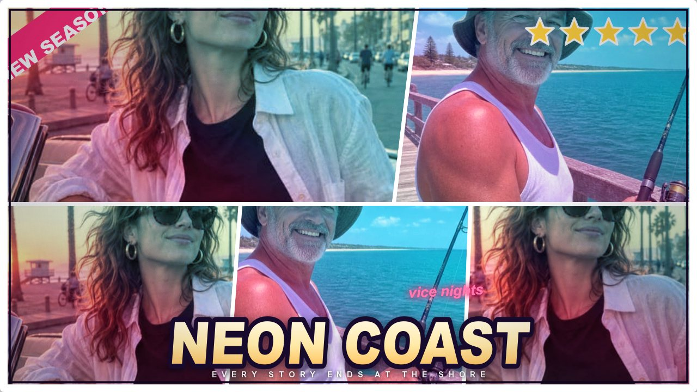
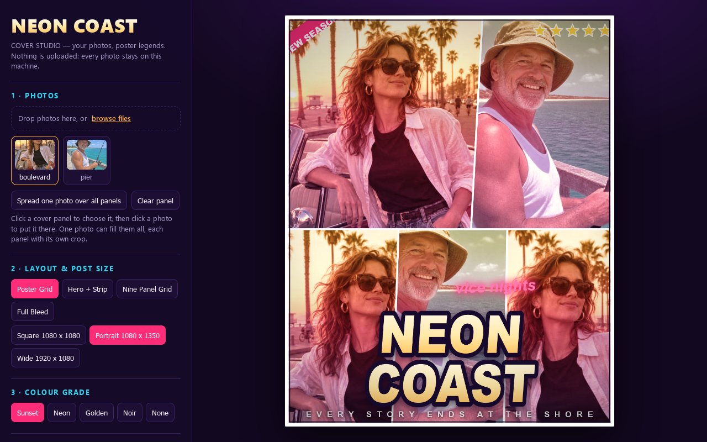
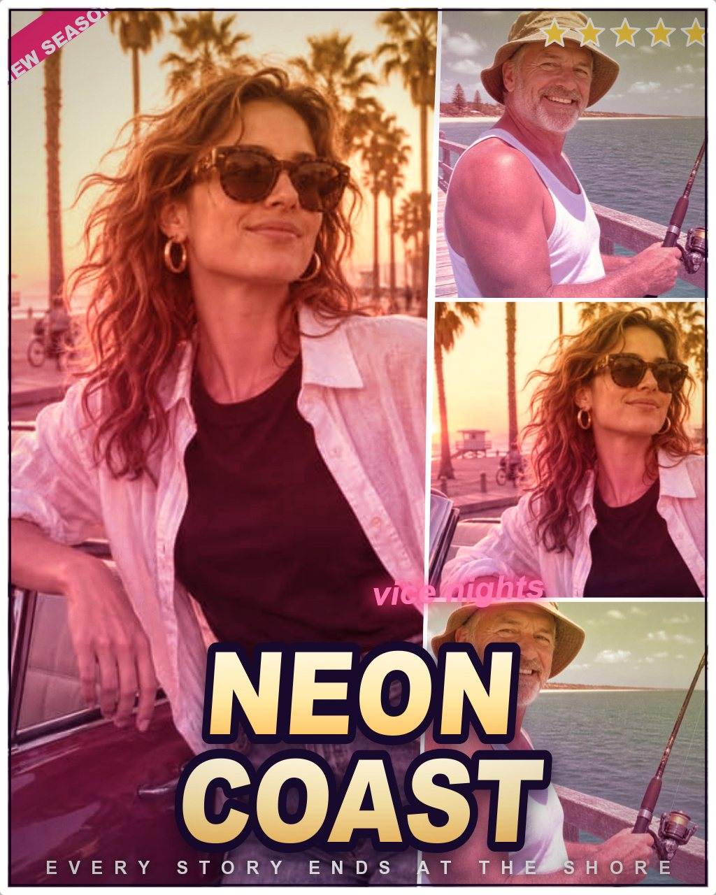
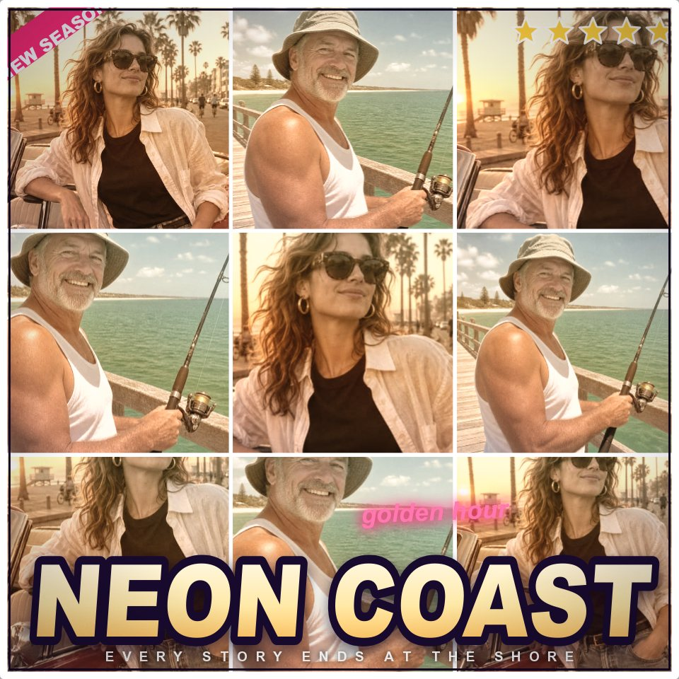

# Neon Coast Cover Studio

Turn your own photos into a multi-panel, open-world poster cover — the slanted
panels, bold condensed lettering and sunset grade of a big-budget game box,
composed live in your browser and exported as a full-resolution PNG. Everything
runs offline from local files; no photo ever leaves your machine.

## What it does

- **Your photos, every panel.** Drop photos onto the page, browse for files, or
  start from the two built-in samples. Click a panel, click a photo, and it is
  in. Drag on a panel to pan its crop, scroll to zoom, or use the per-panel
  sliders. *Spread one photo over all panels* fills the whole grid from a single
  shot with a different crop per panel.
- **Four poster layouts.** Poster Grid (five slanted panels), Hero + Strip (one
  tall hero panel beside a three-panel strip), Nine Panel Grid, and Full Bleed.
- **Poster lettering.** A two-line condensed title with a gold gradient and hard
  outline, a neon script subtitle, a letter-spaced tagline, a corner ribbon
  sticker and a five-star heat row — all drawn as canvas art, all editable.
- **Colour grades.** Sunset, Neon (teal-and-pink vice look), Golden Hour, Noir,
  or None — applied per panel over a colour wash, with optional film grain and
  vignette over the finished poster.
- **Real exports.** One click downloads a PNG at true post size: Square
  1080 × 1080, Portrait 1080 × 1350, or Wide 1920 × 1080.

## Run it

Open `app/index.html` in a desktop browser. That is the whole install — the app
is static, offline, and has no build step.

`main.ts` (Node 22) is the make.fun hand-in entry point: it walks `app/` and
`screenshots/` and writes the dossier the checker reads.

## How it is built

- `app/src/cover.js` — the cover engine: panel geometry, cover-fit photo
  drawing with clamped pan/zoom, canvas-filter colour grades with a colour
  wash, and all poster lettering and furniture.
- `app/src/main.js` — the editor: photo library, panel selection and drag-pan,
  segmented layout/size/grade pickers, per-panel crop sliders, PNG export.
- `app/src/shots.js` — deterministic screenshot scenes driven by `shots.json`.

All artwork is original: the panels, lettering and grades are drawn in code,
and the sample photos are model-made images shipped with the starter kit. No
Rockstar or GTA logos, fonts or artwork are used anywhere.

